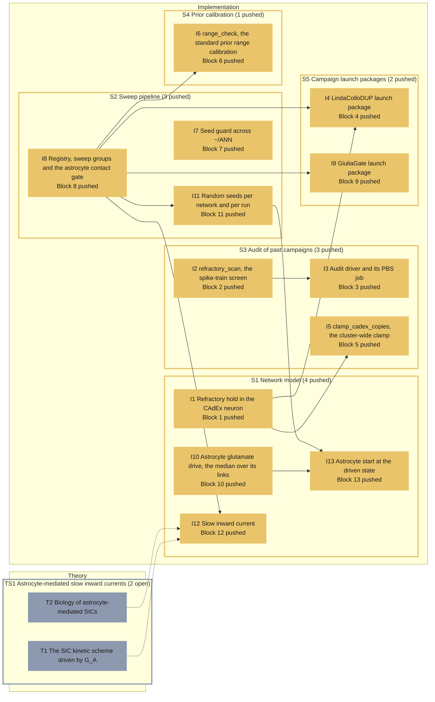

# Roadmap -- Neuron-astrocyte sweep pipeline (hpc/)

Generated by `specs/roadmap/roadmap.py render` from `specs/roadmap/ANN.yaml`; do not edit. Branch `main` at `26d7c5a` (2026-11-04); synced 2026-11-04T14:57:47+00:00 from chat.

## Legend

| State | Colour | Meaning |
|---|---|---|
| planned (implementation) | #d62828 | not implemented |
| local (implementation) | #f77f00 | implemented, not pushed |
| pushed (implementation) | #e9c46a | pushed, not tested |
| testing (implementation) | #3a86ff | independent tester running |
| tested (implementation) | #2a9d8f | tester passed, HPC run missing |
| running (implementation) | #8338ec | HPC job running |
| failing (implementation) | #b5174e | tester or HPC failure on the current code |
| done (implementation) | #2d9a3d | pushed, tested, HPC run done |
| open (theory) | #8d99ae | not started |
| studying (theory) | #3a86ff | being studied |
| closed (theory) | #2d9a3d | closed |

A dashed border marks a stage whose dependency is not in place (a block that is planned, local or failing; a topic not closed). Theory and implementation progress independently: the dotted edges between them are links, not conditions. REVISE marks a stage that has to change because of a decision taken on the other side.

## Theory

| Stage | Group | Status | Closed | Decision | Depends on | Linked blocks | Revise | Summary |
|---|---|---|---|---|---|---|---|---|
| TS1 Astrocyte-mediated slow inward currents |  | open |  |  |  |  |  | the astrocyte-to-neuron SIC pathway, its model and its biology (asked by the author, 2026-11-04) |
| T1 The SIC kinetic scheme driven by G_A | TS1 | open |  |  |  | I12 |  | how the Block 12 receptor scheme turns the gliotransmitter time course into a current - continuous Hill-driven binding and opening, the Mg block, why a per-release kick cannot fit the slow rise, the calibration of k_on, tau_d and g_sic to Kovacs & Pal 2017, the dependence on G0 and Omega_e, and the Voronoi reach rule |
| T2 Biology of astrocyte-mediated SICs | TS1 | open |  |  |  | I12 |  | astrocytic glutamate release, the extrasynaptic GluN2B/GluN2D NMDA receptors that carry SICs and where they sit on the neuron, how many neurons one astrocyte reaches and synchrony, functional roles (excitability, synchrony, plasticity) and the slice-versus-in-vivo caveats |

## Implementation

| Stage | Group | Blocks | Status | Why | Last change | Tester | HPC | Depends on | Theory (open) | Revise | Summary |
|---|---|---|---|---|---|---|---|---|---|---|---|
| S1 Network model |  |  | pushed | group: least advanced member is pushed |  |  |  |  |  |  | the equations of the simulated network that the blocks change - neuron, astrocyte drive, astrocyte-to-neuron current, astrocyte start |
| S2 Sweep pipeline |  |  | pushed | group: least advanced member is pushed |  |  |  |  |  |  | the registry (38 axes since g_sic), the sampling, the records and the seeds of every run |
| S3 Audit of past campaigns |  |  | pushed | group: least advanced member is pushed |  |  |  |  |  |  | how many runs of earlier campaigns lost neurons to the refractory runaway, and the clamp of the cluster copies |
| S4 Prior calibration |  |  | pushed | group: least advanced member is pushed |  |  |  |  |  |  | the standard range check of each setup's prior boxes before a campaign |
| S5 Campaign launch packages |  |  | pushed | group: least advanced member is pushed |  |  |  |  |  |  | the launch folders of the campaigns run from the root pipeline |
| I1 Refractory hold in the CAdEx neuron | S1 | 1 | pushed | no tester report covers commit 46e41ba | 46e41ba 2026-11-04 |  |  |  |  |  | V is held at V_R during t_ref (Gorski et al. 2021), so a neuron cannot run away to NaN |
| I10 Astrocyte glutamate drive, the median over its links | S1 | 10 | pushed | no tester report covers commit 46e41ba | 46e41ba 2026-11-04 |  |  |  |  |  | Y_extra of an astrocyte is the median of Y_A over its synapse links, not the sum that made the astrocytes diverge |
| I12 Slow inward current | S1 | 12 | pushed | no tester report covers commit 46e41ba | 46e41ba 2026-11-04 |  |  | I8 | T1 (open), T2 (open) |  | astrocyte G_A drives extrasynaptic NMDA receptors on its Voronoi-neighbour neurons (no distance cap); always on in Full mode; g_sic per pair is registry axis 37 |
| I13 Astrocyte start at the driven state | S1 | 13 | pushed | no tester report covers commit 46e41ba | 46e41ba 2026-11-04 |  |  | I10, I11 |  |  | every astrocyte starts from the state its own equations reach under the run's drives (the fixed point, or its own phase on the limit cycle) and refractory, so no astrocyte releases because the run starts |
| I8 Registry, sweep groups and the astrocyte contact gate | S2 | 8 | pushed | no tester report covers commit 46e41ba | 46e41ba 2026-11-04 |  |  |  |  |  | the registry (37 axes, 38 since g_sic), the sweep groups and the contact gate stoa_gate_p of the default pipeline |
| I11 Random seeds per network and per run | S2 | 11 | pushed | no tester report covers commit 46e41ba | 46e41ba 2026-11-04 |  |  | I8 |  |  | network-level draws from seeds per topology, run-level draws from a seed applied inside the binary and read back |
| I7 Seed guard across ~/ANN | S2 | 7 | pushed | no tester report covers commit 46e41ba | 46e41ba 2026-11-04 |  |  |  |  |  | a campaign cannot reuse seeds already used under ~/ANN |
| I2 refractory_scan, the spike-train screen | S3 | 2 | pushed | no tester report covers commit 562a9fd | 562a9fd 2026-10-30 |  |  |  |  |  | per-run classification of early-silenced neurons from the spike trains |
| I3 Audit driver and its PBS job | S3 | 3 | pushed | no tester report covers commit 46e41ba | 46e41ba 2026-11-04 |  |  | I2 |  |  | runs the screen over every campaign on davinci and writes the tables |
| I5 clamp_cadex_copies, the cluster-wide clamp | S3 | 5 | pushed | no tester report covers commit 413a4bd | 413a4bd 2026-10-30 |  |  | I1 |  |  | puts the refractory hold into every CAdEx copy under ~/ANN |
| I6 range_check, the standard prior range calibration | S4 | 6 | pushed | no tester report covers commit 46e41ba | 46e41ba 2026-11-04 |  |  | I8 |  |  | corners and interior of each setup's prior on two to four nodes, then the analysis job |
| I4 LindaColloDUP launch package | S5 | 4 | pushed | no tester report covers commit 46e41ba | 46e41ba 2026-11-04 |  |  | I1, I8 |  |  | the neurons-only campaign, launched from a clamped copy of the root pipeline |
| I9 GiuliaGate launch package | S5 | 9 | pushed | no tester report covers commit 46e41ba | 46e41ba 2026-11-04 |  |  | I8 |  |  | Giulia's Full-mode campaign from the root pipeline (the median drive, the seeds, the SIC with g_sic free, the driven astrocyte start) |

